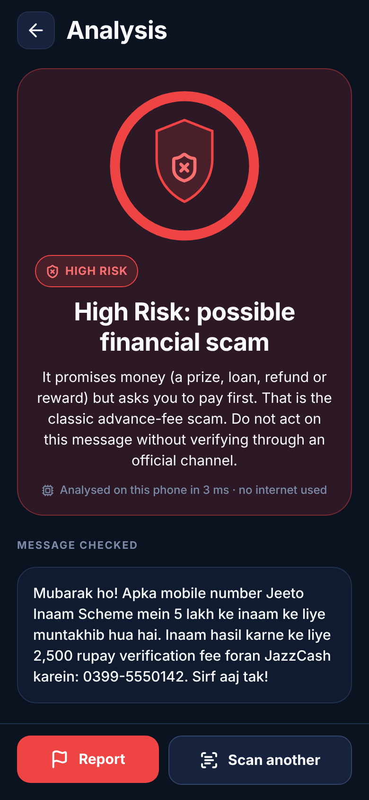
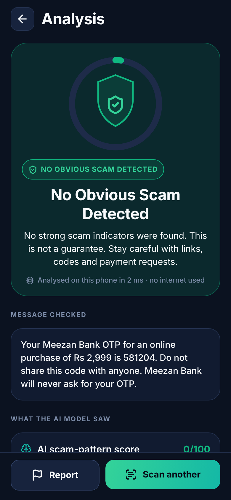
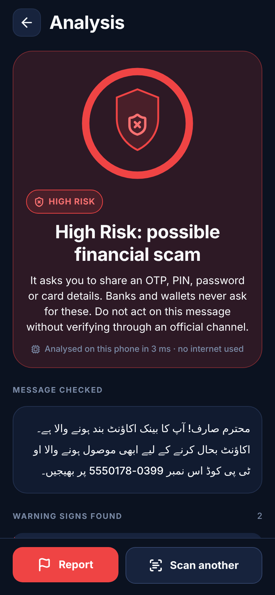
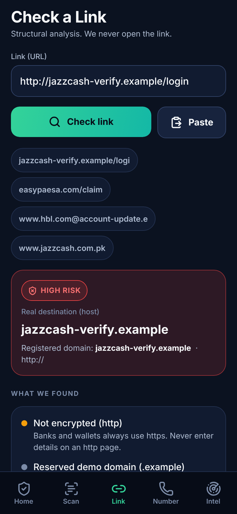

# Hoshiyar Shield 🛡️

**Scams se hoshiyar. Paisa mehfooz.**
Your AI-powered shield against financial scams: an Android app that checks suspicious
financial messages, links and payment numbers **on the phone**, in **Roman Urdu, Urdu script
and English**.

> AICON'26 Build With AI · Financial Operations track · Team: **Mutahar & Uswa**
> Status: working MVP. CI green (30 pytest + 342 Jest tests). A release APK was built by GitHub Actions
> ([run 38011938779](https://github.com/MuhammadMuthar/Hoshiyar-Shield/actions/runs/38011938779), artifact `hoshiyar-shield-apk`).
> It has not yet been installed on a physical phone. See [APK](#android-apk).

| Scam message | Legitimate OTP | Urdu script | Link check |
|---|---|---|---|
|  |  |  |  |

<sub>Screenshots are from the app's web build rendered in Chromium at phone size (390×844). They're real
outputs of the same code and model as the Android app, but Android rendering may differ slightly.</sub>

---

## The problem

Financial scammers in Pakistan exploit **language, urgency and trust**: fake JazzCash/Easypaisa
"account blocked" alerts, callers posing as bank staff who want "the code you just received",
fake prize and BISP payouts that need a "verification fee", fake loans with "processing fees",
and relatives "on a new number" asking for money. Many of these arrive in **Roman Urdu with no
standard spelling** (`paisay / pesay / paise`, `foran / forun`, `bhejein / bhejain / bhejo`),
which defeats keyword filters. Most people are never taught to spot OTP theft, look-alike
domains or advance-fee fraud.

## What Hoshiyar does

| Feature | What it really does |
|---|---|
| **Scan a Message** | Paste or type any SMS/WhatsApp text. A **trained classifier runs on the phone** (no network), a deterministic engine extracts concrete warning cues, and explicit rules combine them into **High Risk / Suspicious / No Obvious Scam Detected**, with reasons and safe actions. |
| **Model-derived explanation** | The model is linear, so the app shows the words that actually pushed *its* score up or down. This is a faithful explanation, not decoration. |
| **Check a Link** | Structural analysis (never opens the link): raw IPs, the `@` trick, punycode, shorteners, risky TLDs, brand names on unofficial domains, look-alike spellings of official bank domains. |
| **Check a Number** | Normalises Pakistani mobile numbers and shows reports. Data is **clearly labelled** as synthetic demo records or your own local reports, and the app never says "safe". |
| **Report a Scam** | Consent-based, validated, rate-limited reports saved **only on the phone**. Message text is never attached unless the user opts in. |
| **Scam Intelligence** | Campaign clustering (char n-gram TF-IDF + agglomerative clustering) over **simulated** reports, showing how consented reports could help banks spot campaigns. |
| **Demo mode** | A 10-message sample library (Roman Urdu, Urdu, English, mixed). Samples only *fill the box*; the real pipeline produces every verdict. |

What it does **not** do (by design, and we say so in the app): read SMS automatically, intercept
calls, block transfers in other apps, verify who owns a number, or guarantee anything is safe.

## AI approach (short version)

- **Data:** 2,457 generated messages → 2,080 after removing normalised duplicates (1,084 scam / 996
  legitimate) from **273 template families** across 8 scam and 9 legitimate categories, in Roman
  Urdu, English, Urdu script and code-switched text. They include many hard negatives (real-looking
  OTP deliveries, security advice, "Mubarak ho" family messages, legitimate loans and refunds).
  Synthetic, with provenance on every row: [`docs/dataset-card.md`](docs/dataset-card.md).
- **Model:** character 2–4-gram TF-IDF + logistic regression. Character n-grams tolerate
  Roman Urdu spelling variation. Hyperparameters and thresholds come from **family-grouped
  cross-validation**, and the test set is **55 template families the model never saw**.
- **On-device:** exported to a 232 KB JSON. A TypeScript port of the normaliser and inference
  matches Python **exactly** on 252 parity fixtures (normalised text identical, |Δscore| < 1e-9).
  Analysis takes about 1–4 ms and works in airplane mode.
- **Fusion:** ML score + negation-aware warning cues ("share your OTP" vs "never share your OTP")
  + URL structure, combined by documented rules F1–F4 ([`docs/architecture.md`](docs/architecture.md)).

### Results (synthetic data: read [`docs/model-evaluation.md`](docs/model-evaluation.md) before quoting)

| Evaluation set | Pipeline | Scam recall (flagged) | False-positive rate | Precision at High Risk |
|---|---|---|---|---|
| Held-out unseen families (416 msgs) | Keyword baseline | 77.4% | **48.2%** | n/a |
| | ML only | 93.5% | 8.0% | 94.3% |
| | **Full app** | **96.8%** | **8.0%** | **94.6%** |
| Hand-written unfamiliar patterns (60) | ML only → full app | 76.7% → 90.0% | 6.7% → 6.7% | 92.3% |
| **Independent set by ChatGPT** (80) | Keyword baseline | 90.0% | **85.0%** | n/a |
| | ML only → full app | 77.5% → 90.0% | 20.0% → **27.5%** | 92.6% → 90.0% |

The last row is the most honest estimate: messages written by a different author who never saw
our templates. Our app produces too many false alarms on security-awareness messages that
*quote* scam phrases. All of this is synthetic data, so real-world performance has **not** been
measured ([`docs/limitations.md`](docs/limitations.md)).

## Repository layout

```
apps/mobile/            Expo SDK 57 · React Native 0.86 · TypeScript · Expo Router
  src/app/              screens (onboarding, tabs: home/scan/link/number/intel, result, report, about)
  src/engine/           pure-TS engine: normalize, classifier, indicators, url, phone, reputation, reports, analyze
  src/components/       design system (Txt, Button, Card, ShieldMeter, RiskBadge, CueList, …)
  src/features/         preferences, session hand-off, opt-in history, local reports (AsyncStorage)
  assets/model/         hoshiyar-model.json, demo-samples.json, campaigns.json (generated)
  __tests__/            UI flow tests (real routes via expo-router/testing-library)
ml/
  data/                 templates*.py, generate_dataset.py, challenge_set.py, demo_samples.json, contrib/ (ChatGPT)
  training/             textnorm.py (shared spec), train.py, jsonmodel.py, baseline.py, report.py
  scripts/              cluster_campaigns.py, make_icons.py
  artifacts/            model JSON, metrics.json, system-metrics.json, parity fixtures, campaigns.json, history/
  tests/                pytest suite
docs/                   architecture, evaluation, dataset card, privacy, limitations, deployment, demo script, PITCH
.github/workflows/      ci.yml (tests) · android-apk.yml (release APK artifact)
```

## Quick start

**Requirements:** Node 22, npm, Python 3.11+ (3.13 used), Android phone with Expo Go *or* the APK.

```bash
# 1) App
cd apps/mobile
npm install
npx expo start            # scan the QR code with Expo Go (Android), or press "a" for an emulator

# 2) Checks
npm run typecheck && npm run lint && npm test        # 342 Jest tests (engine, parity, UI flows)

# 3) ML pipeline (repo root)
python3 -m venv .venv && .venv/bin/pip install -r ml/requirements.txt
.venv/bin/python ml/training/train.py                # generate → split → CV → test → export (~1 min)
.venv/bin/python -m pytest ml/tests -q               # 30 tests
.venv/bin/python ml/scripts/cluster_campaigns.py     # regenerate simulated campaign data
cd apps/mobile && npm run eval:system                # full-pipeline evaluation → docs/system-evaluation.md
```

If `api.expo.dev` is unreachable (restricted networks), prefix Expo commands with `EXPO_OFFLINE=1`.

## Android APK

Three ways to get an installable APK, from easiest to most involved:

1. **GitHub Actions (no account needed).** Every push touching `apps/mobile` runs
   [`android-apk.yml`](.github/workflows/android-apk.yml): `expo prebuild` → `gradlew assembleRelease`.
   Download it from **Actions → Android APK → latest run → Artifacts → `hoshiyar-shield-apk`**.
   The APK is signed with the template's debug keystore, which is fine for sideloading a demo and
   not suitable for the Play Store.
2. **EAS Build** (needs a free Expo account, so a human must log in):
   ```bash
   npm install --global eas-cli
   cd apps/mobile
   eas login                     # human step
   eas init                      # links the project, writes the projectId into app.json
   eas build --platform android --profile preview     # produces an .apk (see eas.json)
   ```
3. **Local Gradle** (needs Android SDK + JDK 17): `cd apps/mobile && npm run apk:local`.

To install, allow "Install unknown apps" for your browser/Files app and open the APK. Full
details: [`docs/deployment.md`](docs/deployment.md).

## Demo

- 5-minute pitch with timings and speaking script: [`docs/PITCH.md`](docs/PITCH.md)
- Click-by-click demo + 90-second emergency demo + pre-flight checklist: [`docs/demo-script.md`](docs/demo-script.md)
- Everything in the demo works in **airplane mode**.

## Security & privacy decisions

No SMS/contacts/call-log/location/camera/microphone permissions (explicitly blocked in
`app.json`). No message text is uploaded. Links are never opened. Reports and opt-in history stay
on the phone. Demo data uses the fictional `0399-555xxxx` range and reserved `.example` domains.
See [`docs/privacy.md`](docs/privacy.md).

## Limitations

Synthetic training and test data. No field validation. English legitimate messages and
awareness messages that quote scam text cause most false alarms. It cannot verify senders or
number ownership, and the official-domain list is a small, manually maintained starter list.
Full list: [`docs/limitations.md`](docs/limitations.md).

## Team & how this was built

- **Mutahar & Uswa**: product owners, review, device testing, presentation.
- **Claude (Claude Code)**: ML pipeline, on-device engine, app, tests, CI, technical docs.
- **ChatGPT**: independent challenge set (evaluation-only), source research, language/pitch review.

The AI collaborators work under a written agreement with file ownership, a handoff log and
honesty rules: [`docs/COLLABORATION.md`](docs/COLLABORATION.md) · [`docs/HANDOFF.md`](docs/HANDOFF.md).

*Decision support only: not a certified fraud-prevention or regulatory system. AI can make mistakes.*
